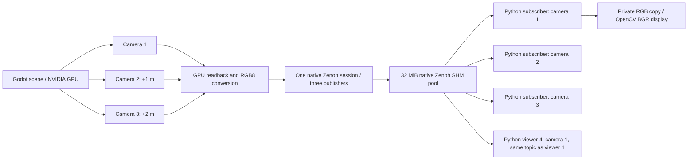
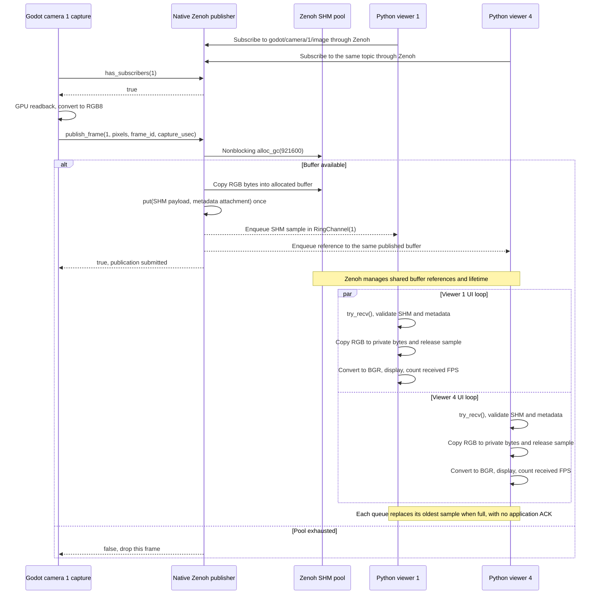

# Godot cameras → Zenoh shared memory → Python

One Godot process renders three cameras. Four independent Python processes display them (two viewers subscribe to camera 1) through **Zenoh 1.10.1 native shared memory**. Each camera produces **640 × 480 RGB8 at 30 FPS**, with a **90° horizontal FOV**. Cameras 2 and 3 are offset +1 m and +2 m along camera 1's right axis, sharing the same world and orientation.

This example targets **x86-64 Linux**, Godot 4.7, CMake 3.22+, Ninja, GCC, Python 3.12, and an NVIDIA GPU with a working proprietary driver. The extension uses the pinned Godot C++ bindings and Zenoh C/C++ SDKs downloaded by CMake. No Rust build or `zenohd` is needed.

## Build

```bash
sudo apt install build-essential cmake ninja-build python3-venv
python3 -m venv .venv
.venv/bin/python -m pip install -r requirements.txt
cmake --preset debug
cmake --build --preset debug
~/.local/bin/godot --editor --path demo --import
```

Adjust the Godot executable path if installed elsewhere. The build places `libcamera_zenoh.so` and its runtime dependency `libzenohc.so` in `demo/bin`. Keep both together. The Zenoh SDK archives are version pinned and SHA-256 verified; `requirements.txt` pins the matching Python package.

## Run on NVIDIA

Start Godot in one terminal:

```bash
__NV_PRIME_RENDER_OFFLOAD=1 __GLX_VENDOR_LIBRARY_NAME=nvidia \
  ~/.local/bin/godot --path demo
```

Confirm its startup log says `Using Device: NVIDIA`. `nvidia-smi` should also show the Godot process. The demo uses Godot's OpenGL Compatibility renderer; GPU rendering is followed by CPU readback for publication.

Start each viewer in its own terminal:

```bash
.venv/bin/python viewer.py --camera 1
.venv/bin/python viewer.py --camera 2
.venv/bin/python viewer.py --camera 3
.venv/bin/python viewer.py --camera 1  # Fourth viewer, same topic as viewer 1
```

In VS Code, run **Build debug**, then **Run camera demo (Godot + Python)**. The compound task starts Godot with NVIDIA offload and all four viewers in five separate terminals. Create `.venv` first. Viewers may start before Godot and reconnect after it restarts. Press **Q**, **Esc**, or close a viewer window to stop that viewer.

The first and fourth viewers display the **same camera in two independent processes** by running `--camera 1` twice. Both subscribe to the same topic and receive the same published image buffers; neither acknowledges frames to the other. Each window includes its PID.

## Topics and wire data

| Camera | Topic | Offset from camera 1 |
| --- | --- | --- |
| 1 | `godot/camera/1/image` | 0 m |
| 2 | `godot/camera/2/image` | +1 m right |
| 3 | `godot/camera/3/image` | +2 m right |

One Godot Zenoh peer listens on `tcp/127.0.0.1:7447`. Python peers connect to it; multicast discovery and Python listening endpoints are disabled. Only one publisher instance can bind this endpoint at a time. No router is required. This is a local trusted-process demo; it does not configure authentication.

Each payload contains exactly **921,600 contiguous RGB bytes**, row-major, top to bottom. There is no alpha channel. Metadata is a separate JSON attachment:

```json
{"version":1,"camera_id":1,"width":640,"height":480,"format":"RGB8","frame_id":100,"capture_usec":3456789,"stream_id":"publisher-zenoh-session-id"}
```

`capture_usec` is Godot's monotonic tick count at the start of readback, not wall-clock time. `frame_id` is the render counter shared in timing by the three capture nodes. Gaps are allowed. `stream_id` changes when Godot opens a new session, allowing frame counters to reset after restart.

Python rejects incorrect metadata, invalid payload lengths, non-increasing frame IDs within a stream, and **any payload for which `sample.payload.as_shm()` is `None`**. This intentionally requires local Zenoh SHM; ordinary network payloads are not a fallback.

## Flow and signaling



The sequence below shows camera 1 publishing once to two independent viewer processes. Cameras 2 and 3 follow the same capture and publication path on their own topics.



The previous sequence diagram failed because `false; drop this frame` contained a bare semicolon. Mermaid treats semicolons as statement separators, so it tried to parse `drop this frame` as another diagram statement and reported a syntax error. The message now uses a comma. To display a literal semicolon, Mermaid requires `#59;`; see its [sequence diagram escaping rules](https://mermaid.js.org/syntax/sequenceDiagram.html#entity-codes-to-escape-characters).


There are **no application READY/ACK messages**, custom TCP framing, or directly named/mapped POSIX buffers. Zenoh carries publication notifications and SHM descriptors over its local connection and manages reference counts. Its matching status lets Godot skip readback when a camera has no subscribers. The viewports still render.

The publisher uses a **32 MiB pool**, nonblocking allocation, and congestion policy `DROP`. It never waits for a viewer to display a frame. Each Python subscriber uses `RingChannel(1)` so stale queued samples are discarded. A slow viewer can miss frames independently. If consumers retain enough SHM references to exhaust the shared pool, new frames are dropped across cameras until space is available; the rendering loop continues.

Transport is SHM-backed, but the complete pipeline is **not zero-copy**: Godot reads GPU pixels back to CPU, copies RGB into Zenoh SHM, and Python makes a private bytes copy before display. Zenoh Python 1.10.1 does not expose a NumPy-compatible SHM buffer protocol. Keeping a private copy avoids retaining a shared sample during OpenCV rendering.

The Python overlay and console report **received/displayed FPS**, including idle intervals. The Godot overlay reports successful publication FPS, dropped frames, and average capture + copy time. Successful publication does not guarantee every subscriber displays every frame.

## Measured NVIDIA performance

The saved 30-second run on 2026-10-17, after startup and a 3-second warmup, used the NVIDIA GeForce RTX 5070 Laptop GPU and **three** separate viewer processes. It predates the fourth viewer; no four-viewer benchmark has been run:

| Process | Average received FPS | Average CPU | Average RSS |
| --- | ---: | ---: | ---: |
| Godot | — | 44.1% | 246.8 MiB |
| Viewer 1 | 30.0 | 44.8% | 259.3 MiB |
| Viewer 2 | 30.0 | 45.2% | 258.1 MiB |
| Viewer 3 | 30.0 | 45.5% | 258.2 MiB |

NVIDIA whole-device utilization averaged **10.6%**, peaking at **11%**, with **116 MiB** VRAM used. CPU 100% means one logical core; RSS includes shared pages and cannot be summed as unique physical memory. This is one short desktop run, not a sustained-load guarantee. All viewers confirmed SHM-backed samples. Godot and the three measured viewers exited cleanly, and no Zenoh SHM files remained afterward.

## Checks

```bash
.venv/bin/python -m unittest discover -s tests -v
.venv/bin/python tests/check_pipeline.py
```

The integration check opens real Zenoh subscribers before Godot, launches NVIDIA rendering, verifies SHM enforcement and RGB pixels, compares duplicate subscribers at common frame IDs, checks distinct offset views, leaves a reader idle, closes it, fills and releases the SHM pool to verify bounded drops and recovery, and restarts the publisher to verify reconnection. It requires an active desktop display and the NVIDIA setup above. Logs go to `build/integration-zenoh*.log`.

On normal shutdown Godot closes its publishers, SHM provider and session, and Python undeclares its subscriber and closes its session. Zenoh retains shared buffers as long as live samples reference them. Close all processes after a test; abrupt kills may defer SDK cleanup.

The SHM APIs are marked unstable by Zenoh; keep the C, C++ and Python versions aligned when upgrading. See the official [C++ SHM example](https://github.com/eclipse-zenoh/zenoh-cpp/blob/1.10.1/examples/zenohc/z_pub_shm.cxx) and [Python SHM subscriber](https://github.com/eclipse-zenoh/zenoh-python/blob/1.10.1/examples/z_sub_shm.py).
