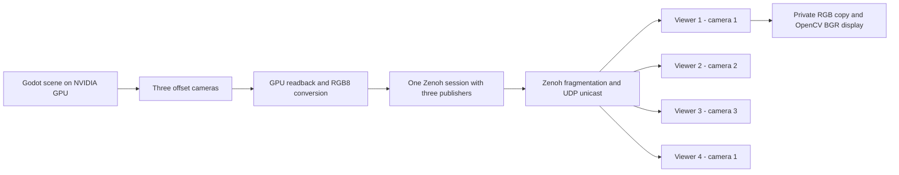
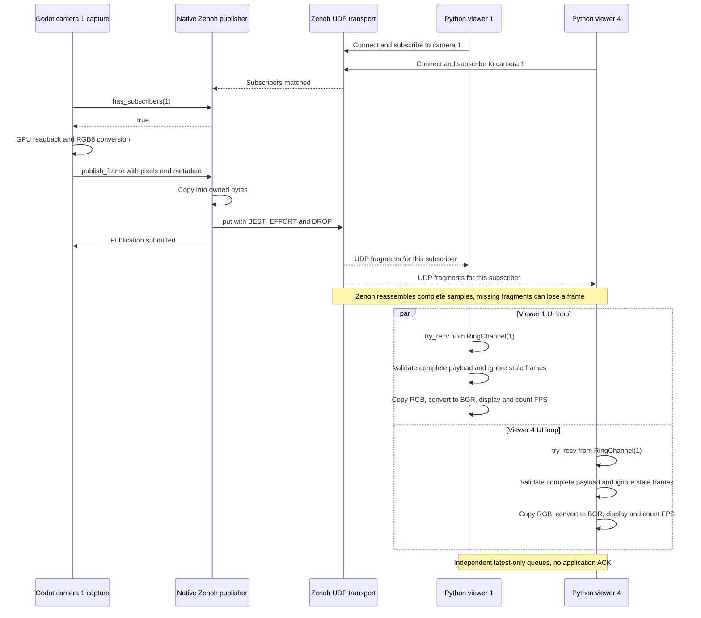

# Godot cameras → Zenoh UDP → Python

The `udp` branch sends image pixels over **Zenoh 1.10.1 UDP unicast**, with **shared memory disabled on both sides**. The original SHM example remains on branch `zenoh` and tag `shm_demo`.

One Godot process renders three **640 × 480 RGB8 cameras at a 30 FPS target**, each with a **90° horizontal FOV**. Cameras 2 and 3 are offset +1 m and +2 m along camera 1's right axis with matching orientations. Four independent Python processes display cameras **1, 2, 3, 1**.

The example targets x86-64 Linux, Godot 4.7, CMake 3.22+, Ninja, GCC, Python 3.12, and an NVIDIA GPU with its proprietary driver and an active graphical desktop. CMake downloads pinned, SHA-256-verified Zenoh C/C++ SDKs. No Rust build or `zenohd` is required.

## Build

```bash
sudo apt install build-essential cmake ninja-build python3-venv
python3 -m venv .venv
.venv/bin/python -m pip install -r requirements.txt
cmake --preset debug
cmake --build --preset debug
~/.local/bin/godot --editor --path demo --import
```

After switching between `udp` and `zenoh`, rebuild the native extension before launching, because the generated libraries in `demo/bin` are shared build artifacts outside Git.

Adjust the Godot executable path if installed elsewhere. The build places `libcamera_zenoh.so` and its runtime dependency `libzenohc.so` in `demo/bin`. Keep both together. The Zenoh SDK archives are version pinned and SHA-256 verified; `requirements.txt` pins the matching Python package.

## Run on NVIDIA

Start Godot in one terminal:

```bash
__NV_PRIME_RENDER_OFFLOAD=1 __GLX_VENDOR_LIBRARY_NAME=nvidia \
  ~/.local/bin/godot --path demo
```

Confirm the startup log says `Using Device: NVIDIA` and `Zenoh UDP publisher listening on udp/127.0.0.1:7447`.

Run each viewer in its own terminal:

```bash
.venv/bin/python viewer.py --camera 1
.venv/bin/python viewer.py --camera 2
.venv/bin/python viewer.py --camera 3
.venv/bin/python viewer.py --camera 1  # Fourth viewer, same topic as viewer 1
```

In VS Code, run **Build debug**, then **Run camera demo (Godot + Python)**. The compound task starts Godot with NVIDIA offload and four viewers in five separate terminals. Each viewer window includes its PID. Press Q, Esc, or close a viewer window to stop that viewer.

Viewers can start before Godot and reconnect when it restarts. Background connection retries increase from 1 second up to 4 seconds, so `Waiting for frames` during startup is normal. The overlay changes to `Live (UDP)` after a complete image arrives.

## Topics and payload

| Camera | Topic | Offset from camera 1 | Viewers |
| --- | --- | --- | --- |
| 1 | `godot/camera/1/image` | 0 m | 1 and 4 |
| 2 | `godot/camera/2/image` | +1 m right | 2 |
| 3 | `godot/camera/3/image` | +2 m right | 3 |

Godot listens on `udp/127.0.0.1:7447`, and each Python Zenoh peer connects there. Only UDP transport is allowed. Shared memory and multicast discovery are disabled, and Python opens no listening endpoints. This is a trusted, local-process demo with a fixed connection address and no authentication or LAN configuration.

Each publication contains exactly **921,600 contiguous RGB8 bytes**, row-major, top to bottom, with no alpha channel. Metadata remains a separate JSON attachment:

```json
{"version":1,"camera_id":1,"width":640,"height":480,"format":"RGB8","frame_id":100,"capture_usec":3456789,"stream_id":"publisher-zenoh-session-id"}
```

`capture_usec` is Godot's monotonic tick count at the start of readback, not wall-clock time. `frame_id` counts render events. Gaps are allowed, and the viewer ignores duplicate or older frames within the same stream. A new `stream_id` permits the counter to reset when Godot restarts.

Python validates metadata and exact image length and rejects unexpected SHM payloads. It makes a private bytes copy before NumPy/OpenCV display. The native publisher owns its copied bytes independently of Godot's temporary image array.

## Flow and signaling



Camera 1's sequence below illustrates two independent subscribers. The other cameras use their own topics.



Zenoh handles fragmentation and reassembly because an image exceeds the size of one UDP datagram. Publications use **best-effort reliability** and congestion policy **DROP**. There is no custom packet protocol, application acknowledgment, frame retransmission, compression, or SHM fallback. Frames can be lost when fragments are lost or transport queues are congested. This example retains Zenoh's bounded transport queue defaults and sets the transmit batch size to **8 KiB** on both peers. Smaller datagrams reduced complete-frame loss on this host compared with Zenoh's roughly 64 KiB default. No system-wide socket settings are changed.

Godot skips readback when a camera has no matching subscribers, although the viewports still render. Each viewer has a `RingChannel(1)` that replaces its oldest queued sample when full. A slow or closed viewer does not require the other viewers to wait for it.

The Python overlay reports completed received/displayed frames over the actual elapsed reporting interval. Godot reports publication submissions and local **Publish failures**, which do not measure UDP packet loss or prove delivery to every subscriber. Thirty FPS is a rendering target, not a delivery guarantee.

At 30 FPS, raw image payload is about **27.6 MB/s per subscriber**, or **110.6 MB/s** across the four unicast viewers, before protocol overhead. Two viewers on camera 1 receive separate network deliveries of the same published image.

## UDP benchmark: 30 seconds

Measured on 2026-10-17 for **30.000 seconds**, sampling CPU, RSS and NVIDIA usage at 1 Hz after initialization and a 3-second warmup. Godot rendered on the **NVIDIA GeForce RTX 5070 Laptop GPU**, with three 640×480 RGB8 cameras targeting 30 FPS and four separate viewers on cameras **1, 2, 3, 1**. Transport was best-effort UDP unicast, SHM disabled, with 8 KiB transmit batches and normal VSync.

| Process | Average received FPS | FPS min–max | Average CPU | Average RSS |
| --- | ---: | ---: | ---: | ---: |
| Godot | — | — | 85.8% | 210.9 MiB |
| Viewer 1 (camera 1) | 14.9 | 7.0–22.9 | 48.6% | 224.2 MiB |
| Viewer 2 (camera 2) | 17.1 | 10.9–22.0 | 49.4% | 223.3 MiB |
| Viewer 3 (camera 3) | 18.2 | 11.9–25.9 | 49.8% | 223.3 MiB |
| Viewer 4 (camera 1) | 17.7 | 9.0–23.8 | 49.4% | 223.2 MiB |

| NVIDIA whole-device metric | Average | Peak |
| --- | ---: | ---: |
| GPU utilization | 7.5% | 10.0% |
| VRAM used | 114.0 MiB | 114.0 MiB |

**This UDP run did not sustain 30 received FPS.** Best-effort fragment loss and latest-only viewer queues can both discard frames; these measurements do not isolate their individual contribution. FPS min/max describe the viewer reporting intervals, not instantaneous rates. CPU 100% means one logical core (16 available). RSS includes shared pages and should not be summed as unique physical memory. GPU metrics cover the whole device, including other clients.

All five demo processes exited cleanly. UDP-only sockets were verified. The historical SHM run below used three viewers, so it is not a controlled transport-only comparison.

Full local results: `build/monitor-udp-nvidia-20261017-080436/` (`report.md`, `summary.json`, raw CSV data and process logs).

## Historical SHM benchmark

The saved 30-second run on 2026-10-17, after startup and a 3-second warmup, used the NVIDIA GeForce RTX 5070 Laptop GPU and **three** separate viewer processes. These are SHM results from `shm_demo`, not measurements of this UDP branch. The four-viewer UDP measurement is shown above:

| Process | Average received FPS | Average CPU | Average RSS |
| --- | ---: | ---: | ---: |
| Godot | — | 44.1% | 246.8 MiB |
| Viewer 1 | 30.0 | 44.8% | 259.3 MiB |
| Viewer 2 | 30.0 | 45.2% | 258.1 MiB |
| Viewer 3 | 30.0 | 45.5% | 258.2 MiB |

NVIDIA whole-device utilization averaged **10.6%**, peaking at **11%**, with **116 MiB** VRAM used. CPU 100% means one logical core; RSS includes shared pages and cannot be summed as unique physical memory. This is one short desktop run, not a sustained-load guarantee. All viewers confirmed SHM-backed samples. Godot and the three measured viewers exited cleanly, and no Zenoh SHM files remained afterward.

## Checks

```bash
.venv/bin/python -m unittest discover -s tests -v
.venv/bin/python tests/check_pipeline.py
```

Unit checks cover ordinary payloads, unexpected SHM, invalid metadata and lengths, private image storage, stale frames, restart identities, and FPS. The rendered integration check verifies complete UDP images, distinct offset views, identical pixels at common frame IDs for duplicate subscribers, subscriber-first startup, slow/closed subscriber independence, and publisher restart. It requires the NVIDIA desktop setup above and writes `build/integration-udp*.log`.

Close Godot and the viewers normally to release their Zenoh sessions. The native library, SDK pinning, camera API, topic names, metadata, and viewer CLI stay compatible with the SHM example, but both sides must use this UDP branch's transport configuration.
