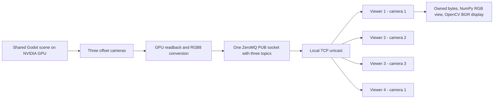
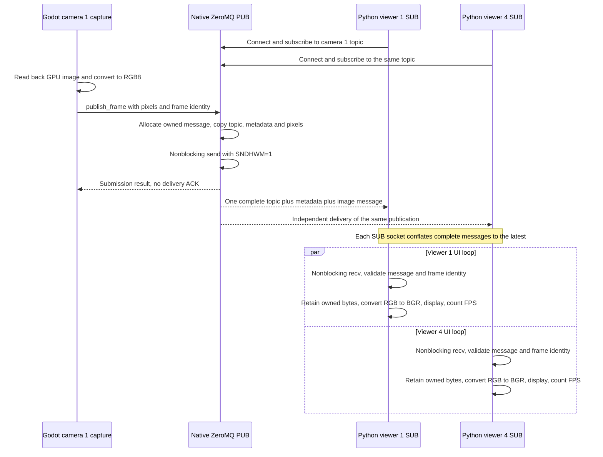

# Godot cameras → ZeroMQ TCP → Python

The `zmq` branch sends complete RGB8 images through **ZeroMQ PUB/SUB over local TCP**, with **no application shared memory**. One Godot process renders three cameras and four Python processes subscribe to cameras **1, 2, 3, 1**. Viewers 1 and 4 subscribe to the same topic independently.

Each camera is **640 × 480 RGB8**, targeting **30 FPS**, with **90° horizontal FOV**. Cameras 2 and 3 are offset +1 m and +2 m to camera 1's right, with matching orientations and the same world. Godot's preview shows camera 1.

## Build

Requires x86-64 Linux, Godot 4.7, GCC, CMake 3.22+, Ninja, and Python 3.12. The NVIDIA checks require an active graphical desktop and a working proprietary NVIDIA driver.

```bash
sudo apt install build-essential cmake ninja-build pkg-config libzmq3-dev python3-venv
python3 -m venv .venv
.venv/bin/python -m pip install -r requirements.txt
cmake --preset debug
cmake --build --preset debug
~/.local/bin/godot --editor --path demo --import
```

Adjust the Godot executable path if installed elsewhere. The extension links against the system `libzmq` (4.3.5 or newer); Python uses `pyzmq`. The development machine has libzmq 4.3.5 and pyzmq 24.0.1. No broker, Zenoh, Rust build, or separate messaging service is needed.

After switching branches, rebuild and import before running: ignored generated libraries and the Godot import cache are shared across checkouts. The extension is `demo/bin/libcamera_zmq.so`.

## Run on NVIDIA

Run Godot in its own terminal:

```bash
__NV_PRIME_RENDER_OFFLOAD=1 __GLX_VENDOR_LIBRARY_NAME=nvidia \
  ~/.local/bin/godot --path demo
```

Confirm the console says `Using Device: NVIDIA` and `ZeroMQ PUB listening on tcp://127.0.0.1:5555`. Start each viewer in a separate terminal:

```bash
.venv/bin/python viewer.py --camera 1
.venv/bin/python viewer.py --camera 2
.venv/bin/python viewer.py --camera 3
.venv/bin/python viewer.py --camera 1  # Fourth viewer, same topic as viewer 1
```

In VS Code, run **Build debug**, then **Run camera demo (Godot + Python)**. The compound task opens five dedicated terminals: Godot and four viewers using `.venv/bin/python`. Each viewer window includes its PID. Q, Esc, or closing a viewer window stops that viewer.

Viewers may start before Godot. ZeroMQ connects and reconnects asynchronously, so the UI remains responsive while waiting. Initial frames can be missed while topic subscriptions propagate. Restarting Godot creates a new publisher-session ID, allowing frame IDs to restart. There is no startup handshake or frame acknowledgment.

## Topics and message format

| Camera | Topic | Offset | Viewers |
| --- | --- | --- | --- |
| 1 | `godot/camera/1/image` | 0 m | 1 and 4 |
| 2 | `godot/camera/2/image` | +1 m right | 2 |
| 3 | `godot/camera/3/image` | +2 m right | 3 |

The native extension owns one context and PUB socket bound to `tcp://127.0.0.1:5555`. Each viewer owns one context and SUB socket, filtering its exact camera topic including the terminating NUL byte. The fixed endpoint is the connection address; there is no discovery service. This is a trusted localhost demo without authentication or LAN configuration.

Each publication is **one ZeroMQ message**, with this layout:

| Field | Representation |
| --- | --- |
| Topic | UTF-8 topic followed by one NUL byte |
| Metadata length | Unsigned 32-bit little-endian integer |
| Metadata | UTF-8 JSON, 1–1,024 bytes |
| Pixels | Exactly 921,600 bytes, row-major 640×480 RGB8, top to bottom |

Example metadata:

```json
{"version":1,"camera_id":1,"width":640,"height":480,"format":"RGB8","frame_id":100,"capture_usec":3456789,"stream_id":"publisher-session-id"}
```

`frame_id` counts render events. `capture_usec` is Godot's monotonic tick count before readback, not wall-clock time and not directly comparable to Python's clock. Python validates topic, framing, metadata, and pixel length. Duplicate or older frame IDs within one session are ignored. Different sessions may restart at frame 1.

The native extension allocates a ZeroMQ-owned message and copies RGB pixels directly into it. Python `recv()` returns privately owned immutable bytes; NumPy references the pixel portion of those bytes without another full image copy. The image remains valid after the message is processed or the socket closes. At 30 FPS, raw pixel payload is about 27.6 MB/s per viewer, or 110.6 MB/s across the four unicast connections, before protocol overhead. GPU readback, native message copying, TCP transfer, and RGB-to-BGR display conversion still incur work.

## Buffering and freshness

The publisher sets **SNDHWM=1**, **SNDTIMEO=0**, and sends with **DONTWAIT**. Each SUB socket sets **CONFLATE=1** to retain its newest complete message, and **MAXMSGSIZE=1 MiB**. All sockets use **LINGER=0** for prompt shutdown. There is no application frame backlog or application ACK. Slow viewers can miss images without blocking the rendering loop or other viewers.

Conflation supersedes receive high-water marks and **does not support multipart messages**. Keeping topic, metadata, and pixels in one message avoids losing individual parts. Each subscriber selects one camera so other topics cannot replace its pending image. The native PUB socket does not use conflation across its three topics. See the [ZeroMQ socket-option documentation](https://libzmq.readthedocs.io/en/latest/zmq_setsockopt.html#zmq-conflate-keep-only-last-message).

A viewer regularly calls nonblocking `recv()` to service its conflated queue. An indefinitely frozen process is not a strict one-frame total-memory guarantee: ZeroMQ internals, partially transferred data, TCP kernel buffers, and UI images also consume memory.

`CAMERA_ZMQ_BUFFER_BYTES` sets the publisher's **SNDBUF** and the viewers' **RCVBUF**, in bytes. It must be a decimal integer from **1,024 through 4,194,304**. Set it in every process when comparing sizes, or export it before launching the compound task. The benchmark runner applies it consistently to all children. Linux may adjust/double requested socket buffer sizes and enforce kernel limits; no system-wide socket settings are modified.

```bash
export CAMERA_ZMQ_BUFFER_BYTES=65536
```

The default is **65,536 bytes (64 KiB)**, selected by the measurements below. The Godot overlay counts publication submissions and local send failures, which are not proof of delivery: PUB may silently drop messages at its high-water mark or when no subscribers are connected. The Python overlay counts completed received/displayed frames over each actual elapsed reporting interval. Thirty FPS is a target rather than a delivery guarantee.

## Flow and sequence



Camera 1 publishes once, and ZeroMQ delivers independently to its two subscribers:



## Measured buffer tuning and NVIDIA performance

Measured on **2026-10-17**, with three 640×480 RGB8 cameras and **four real viewer processes** on cameras 1, 2, 3, 1. Each run started after every viewer received frames and a 3-second warmup. Godot used the NVIDIA GeForce RTX 5070 Laptop GPU with normal VSync.

Ten-second buffer comparisons (requested kernel bytes per socket, with SNDHWM=1 and SUB conflation):

| Buffer request | Viewer 1 FPS | Viewer 2 FPS | Viewer 3 FPS | Viewer 4 FPS | Godot CPU |
| --- | ---: | ---: | ---: | ---: | ---: |
| 64 KiB | 29.98 | 30.01 | 30.05 | 30.02 | 45.8% |
| 256 KiB | 29.98 | 30.06 | 30.06 | 30.02 | 49.9% |
| 1024 KiB | 29.97 | 30.04 | 29.93 | 29.96 | 48.9% |

**Selected default: 64 KiB (65,536 bytes)** for publisher SNDBUF and viewer RCVBUF. All candidates met the 29 FPS threshold in every viewer; 64 KiB was the smallest tested request that qualified. This is a measured default for this host, not a universal optimum.

The final **30.001-second** run used the selected 64 KiB default, with 30 resource samples at 1 Hz:

| Process | Average received FPS | FPS min–max | Average CPU | Peak CPU | Average RSS | Peak RSS |
| --- | ---: | ---: | ---: | ---: | ---: | ---: |
| Godot | — | — | 48.4% | 52.0% | 207.4 MiB | 207.4 MiB |
| Viewer 1 (camera 1) | 30.02 | 29.7–30.9 | 46.5% | 50.0% | 213.1 MiB | 213.1 MiB |
| Viewer 2 (camera 2) | 30.03 | 29.7–31.0 | 46.1% | 49.0% | 215.6 MiB | 215.6 MiB |
| Viewer 3 (camera 3) | 29.98 | 29.7–30.9 | 46.7% | 49.0% | 212.6 MiB | 212.6 MiB |
| Viewer 4 (camera 1) | 29.99 | 29.7–31.0 | 46.6% | 49.0% | 212.5 MiB | 212.5 MiB |

| NVIDIA whole-device metric | Average | Peak |
| --- | ---: | ---: |
| GPU utilization | 10.9% | 12.0% |
| VRAM used | 114.0 MiB | 114.0 MiB |

CPU 100% means one logical core (16 available). RSS includes shared pages and should not be summed as unique physical memory. NVIDIA metrics cover the whole device, including other clients. FPS min/max describe viewer reporting intervals. All four viewers and Godot exited cleanly; the runner verified TCP-only connections and absence of application SHM mappings. This is a short desktop run, not a long-duration stability or latency guarantee.

Final raw results: `build/benchmark-zmq-65536-20261017-082206-156146/`. Tuning results: `build/zmq-buffer-tuning.json`. CSV samples, JSON summaries, process logs, and TCP socket information are kept in those local build artifacts.

## Checks and benchmarks

```bash
.venv/bin/python -m unittest discover -s tests -v
.venv/bin/python tests/check_pipeline.py
.venv/bin/python tools/benchmark_zmq.py --tune
.venv/bin/python tools/benchmark_zmq.py
```

Unit checks cover framing, topic isolation, metadata, pixel length, image ownership, stale frames, restart identities, buffer validation, FPS, and the buffer-selection rule. The rendered integration check verifies real native image delivery, common-frame pixel equality for duplicate subscribers, distinct camera views, subscriber-first startup, a paused/closed reader, freshness after resuming, and publisher restart.

`--tune` measures **64 KiB, 256 KiB, and 1 MiB** socket-buffer requests for **10 seconds each**, after all four real viewers receive frames and a 3-second warmup. It chooses the smallest size for which every viewer averages at least 29 FPS. If none qualifies, it chooses the highest minimum viewer-average FPS, rounding ties to 0.1 FPS and favoring the smaller buffer. It reports a recommendation without rewriting source defaults.

The ordinary benchmark measures **30 seconds**, sampling process CPU/RSS and NVIDIA whole-device GPU/VRAM at 1 Hz. It verifies NVIDIA rendering, TCP sockets, absence of application SHM mappings, and clean exits. Raw CSV, JSON summaries, process logs, and TCP socket information are saved under `build/benchmark-zmq-*`; tuning selection is in `build/zmq-buffer-tuning.json`. The final summary is also copied to `build/zmq-benchmark-latest.json`.
