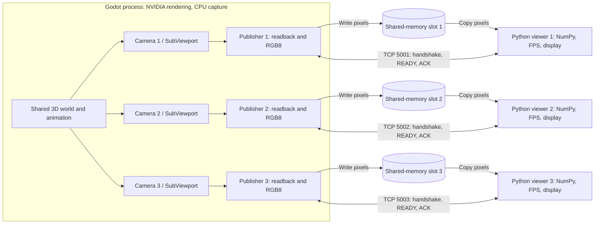
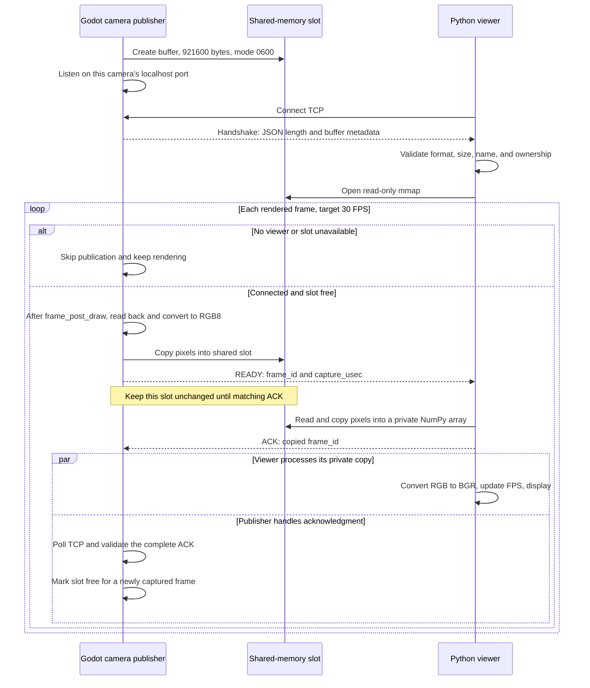

# Godot camera → Python through shared memory

A Linux example with one animated 3D scene and **three 640×480 RGB8 cameras**, each with **90° horizontal FOV** (about 73.74° vertical) and a **30 FPS target**. Each Python viewer displays one camera with its own live **Received FPS** overlay. Godot also reports each camera's published FPS and average capture-plus-copy time. The frame-rate cap is set in `demo/project.godot`.

Camera 2 is **1 metre to camera 1's right**; camera 3 is **2 metres to camera 1's right**. All three have the same orientation. Adjust `SECOND_CAMERA_OFFSET` and `THIRD_CAMERA_OFFSET` in `demo/main.gd` in camera 1's local coordinates (+X right, +Y up, -Z forward). All cameras share the same world and animation. Godot's preview shows camera 1.

## Build

Requires Linux x86-64, Godot 4.5 or newer, Python 3 with NumPy and OpenCV, CMake, Ninja, Git, and a C++ compiler. NVIDIA rendering also requires a working NVIDIA driver and a graphical desktop session. Godot 4.7.2 and the RTX 5070 Laptop GPU were used for the local checks.

Run commands from the repository root. If the Python packages are missing, create and activate a virtual environment first:

```bash
python3 -m venv .venv
source .venv/bin/activate
python3 -m pip install -r requirements.txt
```

Build the native shared-memory extension and import the Godot project:

```bash
cmake --preset debug
cmake --build --preset debug
godot --editor --path demo --import
```

The first configure downloads pinned Godot 4.5 C++ bindings and builds a trimmed set of classes. The editor import command exits after import. Rebuild the extension after changing `src/shared_frame_buffer.cpp`.

## Run on NVIDIA

Use four terminals in the repository root. Activate `.venv` in each Python terminal if you created it above.

**Terminal 1 — Godot and all three camera publishers:**

```bash
__NV_PRIME_RENDER_OFFLOAD=1 __GLX_VENDOR_LIBRARY_NAME=nvidia godot --path demo
```

These NVIDIA PRIME offload variables select NVIDIA for Godot's OpenGL Compatibility renderer. They apply to this Godot command; the Python viewers receive CPU image arrays and do not require NVIDIA offload.

Verify the startup renderer line contains **`Using Device: NVIDIA`**. For example:

```text
OpenGL API 3.3.0 NVIDIA 580.178.04 - Compatibility - Using Device: NVIDIA - NVIDIA GeForce RTX 5070 Laptop GPU
```

The version numbers depend on the installed driver. A line naming Intel means that run is using Intel. `nvidia-smi` can show GPU activity and memory use, but the Godot renderer line confirms which GPU Godot selected.

**Terminal 2 — camera 1:**

```bash
python3 viewer.py
```

**Terminal 3 — camera 2:**

```bash
python3 viewer.py --port 5002
```

**Terminal 4 — camera 3:**

```bash
python3 viewer.py --port 5003
```

| Camera | Local TCP address | Offset from camera 1 | Pixel buffer |
|---|---|---|---|
| 1 | `127.0.0.1:5001` (default) | None | Own shared-memory segment |
| 2 | `127.0.0.1:5002` | 1 metre right | Own shared-memory segment |
| 3 | `127.0.0.1:5003` | 2 metres right | Own shared-memory segment |

Window titles identify the camera port. Closing any viewer leaves the other cameras running.

Press **Q**, **Escape**, or close the viewer window to exit. The viewer can start before Godot and reconnects if Godot restarts. Close Godot normally to release and unlink its shared-memory segment. Do not use Godot's `--headless`: it disables camera rendering. A display and working graphics driver are required.

### VS Code

After building and importing, choose **Terminal → Run Task → Run camera demo (Godot + Python)**. It launches Godot on NVIDIA and all three Python viewers in parallel, each in its own dedicated terminal. Individual publisher and viewer tasks are also available.

**Ctrl+Shift+B** builds using the debug presets. **F5** builds and launches only Godot through GDB on NVIDIA; start the viewer tasks separately when debugging.

The Godot task and debugger use `~/.local/bin/godot`; adjust `.vscode/tasks.json` and `.vscode/launch.json` if Godot is installed elsewhere. Viewer tasks use `python3`. If packages are installed only in `.venv`, change each viewer task's `command` to `${workspaceFolder}/.venv/bin/python`.

## Data flow

One Godot process renders the shared scene through three `SubViewport`s. Each viewport has a camera and a separate publisher from `demo/camera_publisher.gd`. The C++ extension writes pixels to Linux shared memory; each `viewer.py` process reads only its own camera.

The diagrams use Mermaid. View this file on GitHub or in a Markdown preview with Mermaid support.



The two communication paths serve different purposes:

- **Shared memory carries pixels:** one tightly packed `480 × 640 × 3` RGB8 array per camera, **921,600 bytes**.
- **Localhost TCP carries control messages:** the initial buffer description, a **READY** notification, and an **ACK** acknowledgment. Image pixels never pass through TCP.

Readback means transferring the rendered image from GPU storage to CPU-accessible memory. Shared memory avoids sending those pixels through a socket, but GPU readback, RGB conversion, and CPU copies still occur.

## Signaling sequence

This sequence runs independently for each camera. **Python knows a new frame is available when the socket becomes readable and it has received a complete READY message.** It does not poll shared-memory pixels or watch a file for changes.



Godot handles TCP without blocking its render loop. While awaiting ACK, it skips new publications for that camera. Python uses nonblocking socket reads and `select` between OpenCV window updates. Partial TCP messages are retained until complete; a partly sent ACK is retried, and Godot frees the slot only after receiving the full matching frame ID.

**The copy must finish before ACK.** `numpy.frombuffer()` alone creates a view into the shared slot. The receiver calls `.copy()` so Godot can overwrite the shared buffer after ACK while Python safely converts and displays its private image. ACK means “pixels copied,” not “image displayed.”

| Slot state | Godot | Python |
|---|---|---|
| Free, before READY | May write the next captured image | Waits for READY |
| Published, awaiting ACK | Leaves pixels unchanged; skips new publications | Copies pixels, then acknowledges |

No semaphore, shared frame-counter polling, or `mmap.flush()` is used. Buffer ownership is coordinated through the ordered socket messages. This keeps a single frame in flight per camera instead of building a queue of old images.

Each camera has its own publisher (`demo/camera_publisher.gd`), shared-memory slot, socket, and ACK state. A slow or disconnected viewer does not hold the other camera's slot. This is a single-slot example per camera, not a queue. `frame_id` advances every rendered frame, so gaps are expected when frames are skipped. All publishers count the same render events, but independently skipped frames mean the viewers are not guaranteed to display matching IDs. The notification timestamp is Godot's monotonic microsecond clock sampled before each camera's readback; it is not wall time and should not be subtracted directly from Python's clock.

Each publisher owns its POSIX shared-memory segment (mode `0600`). Python opens its `/dev/shm` file read-only using `mmap`, so it does not create a Python shared-memory resource tracker that could unlink the producer's buffer. Only one local consumer per camera is supported.

If a viewer disconnects, its publisher resets that connection's state and accepts a new connection with a fresh handshake. The other publishers continue independently. A connected viewer that stops acknowledging holds only its own camera's slot. Viewers retry connections if Godot is unavailable or restarts. On normal Godot shutdown, each publisher unmaps and unlinks its segment.

### Wire format

All integers are unsigned, little-endian. TCP reads/writes may be partial; both sides retain incomplete messages.

1. **Handshake:** `uint32` JSON byte length (at most 1024), followed by UTF-8 JSON: `version=1`, `shm`, `width=640`, `height=480`, `format="RGB8"`, `bytes=921600`.
2. **READY:** `uint64 frame_id`, `uint64 capture_usec` (16 bytes).
3. **ACK:** matching `uint64 frame_id` (8 bytes), sent only after the pixel copy completes.

READY transfers ownership to Python; ACK transfers it back. No shared-memory polling, cross-process Python lock, or `mmap.flush()` is needed. The socket notification follows the completed write on this Linux setup. The shared-memory name and frame storage are fresh for each Godot run; each connection starts with a handshake.

## FPS and performance

The Python overlay counts complete frame copies over the actual elapsed monotonic time, updating about once per second. It does **not** count window refreshes. It shows “Waiting for frames” before the first image and “No frames” after one second without a new image. FPS falls to zero during idle periods.

The pipeline still includes **GPU → CPU readback**, conversion to RGB8, one copy into shared memory, and one copy into Python-owned storage per camera. The private Python copy lets the producer safely reuse the slot while Python converts and displays the image. Each frame is **921,600 bytes**, with raw pixel traffic of about **27.6 MB/s per camera at 30 FPS**, or **82.9 MB/s for all three cameras**; the copies add memory traffic. RGB8 has no alpha channel, and uses 25% less payload space than RGBA8. Rebuild the extension and restart Godot and the viewers when updating from the RGBA8 version; the viewer rejects the old format.

Godot targets 30 FPS; this is not a real-time guarantee. Readback, rendering, socket round trips, the display refresh rate, and Python processing can reduce delivery FPS. Keep the viewer visible when comparing rates.

## Checks

```bash
python3 -m unittest discover -s tests -v
```

Tests cover FPS timing and idle reset, fragmented notifications, copy-before-ACK ownership, invalid metadata and buffer sizes, duplicate frame IDs, and disconnects.

For a rendered integration check (requires a display, a built/imported demo, and free ports 5001, 5002, and 5003):

```bash
__NV_PRIME_RENDER_OFFLOAD=1 __GLX_VENDOR_LIBRARY_NAME=nvidia python3 tests/check_pipeline.py
```

The integration check launches Godot, compares different camera views at matching frame IDs, checks RGB images, pauses readers to verify buffer ownership and independence, reconnects, measures all three cameras' FPS, and verifies all three shared-memory segments are removed. It does not launch the OpenCV viewers.

This example deliberately skips compression, multiple buffer slots, and asynchronous GPU readback. The socket is local-only but does not authenticate other processes running as the same user. Termination signals (including terminal Ctrl+C) can bypass scene cleanup; an orphan named `godot_camera_<PID>_<timestamp>` may remain in `/dev/shm` after interruption and can be removed once that publisher is gone. Close the Godot window normally to clean up automatically.
