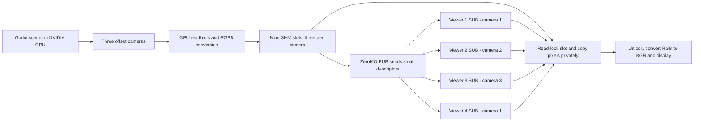
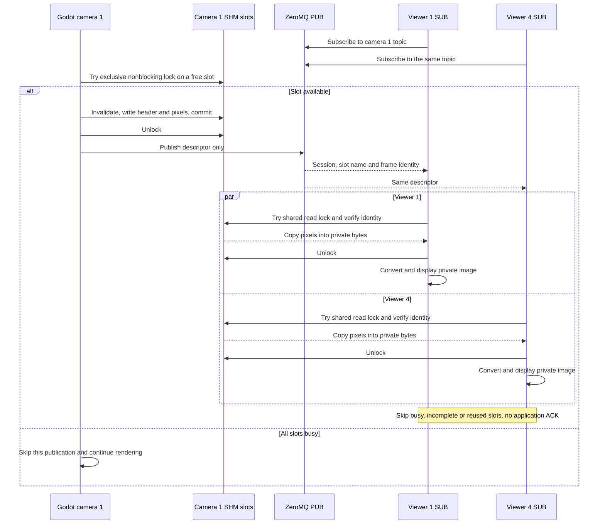

# Godot cameras → shared memory, with ZeroMQ signaling

The `zmq_shm` branch keeps ZeroMQ PUB/SUB for topic notifications and transports **image pixels through POSIX shared memory**. One Godot process renders three cameras; four Python viewer processes subscribe to cameras **1, 2, 3, 1**. Viewers 1 and 4 independently read the same camera's storage.

Each camera produces **640×480 RGB8**, targets **30 FPS**, and has **90° horizontal FOV**. Cameras 2 and 3 are offset +1 m and +2 m to camera 1's right, with matching orientations in the same world. The original image-over-TCP example remains on branch `zmq` at `b2356e3`.

## Build and run

Requires x86-64 Linux, Godot 4.7, GCC, CMake 3.22+, Ninja, Python 3.12, and a graphical desktop. NVIDIA rendering requires its proprietary driver. The native extension uses system libzmq 4.3.5 or newer; the development machine uses libzmq 4.3.5 and pyzmq 24.0.1.

```bash
sudo apt install build-essential cmake ninja-build pkg-config libzmq3-dev python3-venv
python3 -m venv .venv
.venv/bin/python -m pip install -r requirements.txt
cmake --preset debug
cmake --build --preset debug
~/.local/bin/godot --editor --path demo --import
```

Adjust the Godot executable path if installed elsewhere. Rebuild and import after switching branches: ignored native libraries and Godot's import cache are shared build artifacts.

Start Godot in one terminal:

```bash
__NV_PRIME_RENDER_OFFLOAD=1 __GLX_VENDOR_LIBRARY_NAME=nvidia \
  ~/.local/bin/godot --path demo
```

Confirm the console says `Using Device: NVIDIA` and `ZeroMQ SHM PUB listening on tcp://127.0.0.1:5555`. It also lists the nine SHM slot names it owns. Start each viewer in a separate terminal:

```bash
.venv/bin/python viewer.py --camera 1
.venv/bin/python viewer.py --camera 2
.venv/bin/python viewer.py --camera 3
.venv/bin/python viewer.py --camera 1  # Fourth viewer, same topic as viewer 1
```

In VS Code, run **Build debug**, then **Run camera demo (Godot + Python)**. Five dedicated terminals run Godot and the four viewers. Each viewer window includes its PID; Q, Esc, or closing its window stops it.

Viewers can start before Godot and automatically reconnect when it restarts. Initial notifications may be missed while ZeroMQ subscriptions propagate. The application is for trusted processes on the same Linux host; it does not configure authentication or remote image transport.

## Topics and protocol

| Camera | Topic | Offset | Viewers |
| --- | --- | --- | --- |
| 1 | `godot/camera/1/image` | 0 m | 1 and 4 |
| 2 | `godot/camera/2/image` | +1 m right | 2 |
| 3 | `godot/camera/3/image` | +2 m right | 3 |

One native ZeroMQ PUB socket binds to `tcp://127.0.0.1:5555`. Each viewer has a SUB socket filtering its exact camera topic including a terminating NUL. Each notification is **one complete ZeroMQ message**, containing the NUL-terminated topic, a little-endian uint32 JSON length, and UTF-8 JSON. There are **no image bytes** in the ZeroMQ message. Metadata is limited to 1,024 bytes and the entire notification to 2 KiB.

Example descriptor:

```json
{"version":2,"camera_id":1,"width":640,"height":480,"format":"RGB8","bytes":921600,"frame_id":123,"capture_usec":3456789,"stream_id":"12345-6789012345","slot":2,"shm_name":"/godot_camera_zmq_12345-6789012345_c1_s2"}
```

Protocol version 2 intentionally rejects the version-1 image-over-TCP messages. `frame_id` counts render events; `capture_usec` is Godot's monotonic tick count before readback, not wall time or a timestamp directly comparable with Python's clock. A new publisher gets a unique session ID and new SHM names, allowing frame counters to reset safely.

Each camera has **three independently lockable SHM slots**, for nine objects total. Every object has mode `0600` and is exactly **921,728 bytes**: a 128-byte header and 921,600 contiguous RGB8 pixel bytes. Total pixel storage is approximately **7.9 MiB**.

The header is explicitly serialized little-endian, matching Python's `struct.Struct("<8s6I4Q64s")`:

| Header fields in order | Encoding |
| --- | --- |
| Magic `GCSHM02` plus NUL | 8 bytes |
| Version, camera ID, slot index, width, height, pixel-format code (`1` = RGB8) | Six uint32 values |
| Pixel byte count, frame ID, capture timestamp, completion flag (`0` = incomplete, `1` = complete) | Four uint64 values |
| ASCII publisher-session ID, padded with NUL bytes | 64 bytes |

Pixels follow the header, row-major, top to bottom, with no alpha channel.

## Slot ownership and synchronization

1. Godot tries slots in rotating order with `flock(LOCK_EX | LOCK_NB)`. If all three are busy, it skips that camera's publication without waiting.
2. While holding the exclusive lock, it invalidates the old completion flag, writes the header and pixels, and commits the completion flag only after the data is complete. It unlocks before publishing the descriptor.
3. Each viewer opens its notified object read-only, validating its name, owner, exact permissions, and size. It caches at most three mappings for its camera and retains the associated descriptors for locking.
4. The viewer tries `flock(LOCK_SH | LOCK_NB)`. It verifies the committed header matches the descriptor's session, camera, slot, frame, format, size, and timestamp, then copies pixels into private bytes while still locked.
5. It unlocks in `finally`. NumPy/OpenCV use the private copy, so a slow display cannot keep an SHM image alive accidentally.

Multiple viewers can hold shared reader locks simultaneously. Writers require an exclusive lock and therefore cannot overwrite a slot being copied. A locked slot, an incomplete write, a stale frame notification, or an already-reused slot is skipped normally. Missing SHM objects during restart are also skipped; malformed descriptors and invalid object/header layouts produce stream errors.

This is **independent latest-frame delivery**, not a barrier across subscribers or cameras. Viewers may display different frame IDs. No subscriber registry, per-frame ACK, lease, or shared reference count is needed. Missed notifications do not strand slots: ownership is determined by OS locks. All cooperating processes must honor those advisory locks. See [Linux flock semantics](https://man7.org/linux/man-pages/man2/flock.2.html).

The PUB socket retains SNDHWM=1, SNDTIMEO=0, and nonblocking sends. Each SUB uses CONFLATE=1 and receives regularly to service its latest-notification queue. All sockets use LINGER=0. Keeping descriptors in a single message avoids multipart/conflation incompatibility.

The signaling socket buffer default remains **64 KiB**. `CAMERA_ZMQ_BUFFER_BYTES` overrides publisher SNDBUF and viewer RCVBUF, accepting decimal integers from 1,024 through 4,194,304. It controls signaling sockets, **not SHM slot size**. Linux may adjust the actual kernel sizes. No system-wide socket settings are changed.

The Godot overlay reports notification submissions and local skipped/failed publications, including busy slots. ZeroMQ PUB may silently drop notifications, so a successful submission is not proof of delivery. The Python overlay reports completed private frame copies over actual elapsed intervals and displays `Live (ZeroMQ SHM)` while receiving frames. Thirty FPS remains a target, not a delivery guarantee.

## Flow and sequence



Camera 1's two viewers independently read one publication:



## Shutdown, crashes and cleanup

Normal Godot shutdown closes and unlinks only its own nine SHM objects. Already-open mappings remain valid until their readers close them. A new session makes viewers close their old mappings. Viewer shutdown closes every mapping, descriptor, and ZeroMQ socket.

When a process dies, the OS closes its descriptors and releases its locks. The completion flag prevents a reader from accepting pixels left partially written by a crashed producer. Killing a reader cannot permanently strand a slot lock.

An abrupt publisher kill can leave orphaned SHM names. The test/benchmark harness removes only the objects recorded for its own stopped publishers. For manual cleanup, first stop the affected publisher and viewers, confirm the PID/session in the startup log belongs to that stopped run, and remove only those exact logged names under `/dev/shm`. Do not delete all shared-memory files or objects belonging to another run. Restart never reuses stale session names.

## Measured NVIDIA performance

Measured on **2026-10-17** for **30.002 seconds**, at 1 Hz after initialization and a 3-second warmup. Three 640×480 RGB8 cameras targeted 30 FPS, with four separate viewer processes on cameras **1, 2, 3, 1**. Godot used the NVIDIA GeForce RTX 5070 Laptop GPU, normal VSync, three SHM slots per camera, and 64 KiB signaling socket buffers.

| Process | Average received FPS | FPS min–max | Average CPU | Peak CPU | Average RSS | Peak RSS |
| --- | ---: | ---: | ---: | ---: | ---: | ---: |
| Godot | — | — | 46.1% | 49.0% | 211.3 MiB | 211.3 MiB |
| Viewer 1 (camera 1) | 30.01 | 28.9–30.9 | 46.0% | 49.4% | 213.9 MiB | 213.9 MiB |
| Viewer 2 (camera 2) | 30.01 | 28.8–31.8 | 46.3% | 49.0% | 215.2 MiB | 215.6 MiB |
| Viewer 3 (camera 3) | 30.00 | 28.7–30.9 | 46.4% | 49.0% | 213.7 MiB | 213.7 MiB |
| Viewer 4 (camera 1) | 30.03 | 29.7–30.9 | 46.6% | 52.0% | 214.9 MiB | 215.5 MiB |

| NVIDIA whole-device metric | Average | Peak |
| --- | ---: | ---: |
| GPU utilization | 9.5% | 12.0% |
| VRAM used | 114.0 MiB | 114.0 MiB |

CPU 100% means one logical core (16 available). RSS includes shared pages and should not be summed as unique physical memory. GPU metrics cover the whole device, including other clients. FPS min/max describe the viewer reporting intervals. This is a short desktop run, not a long-duration stability or latency guarantee.

All four viewers and Godot exited cleanly, and all nine SHM objects were removed. The runner verified TCP signaling and expected SHM mappings in all five processes. Raw results: `build/benchmark-zmq-shm-65536-20261017-102611-347592/`.

## Checks and benchmark

```bash
.venv/bin/python -m unittest discover -s tests -v
.venv/bin/python tests/check_pipeline.py
.venv/bin/python tools/benchmark_zmq.py
```

Unit checks cover descriptors, header layout/identity, invalid object permissions/size/type, incomplete and reused slots, private image ownership, session mapping cleanup, and interrupted writes. The native integration check covers duplicate-subscriber pixel equality, camera offsets, subscriber-first startup, slot rotation around readers, all-slots-busy behavior, killed readers, publisher restart, killed publishers, mapping cleanup, and normal SHM unlinking.

The benchmark launches NVIDIA Godot and four actual viewer processes, waits for images, warms up for 3 seconds, then measures **30 seconds** of FPS, per-process CPU/RSS, and whole-device NVIDIA utilization/VRAM. It verifies TCP signaling, nine publisher SHM mappings, at most three mappings per viewer, and normal cleanup. Results are saved under `build/benchmark-zmq-shm-*` and `build/zmq-shm-benchmark-latest.json`. Optional `--tune` compares only signaling socket buffers and writes `build/zmq-shm-buffer-tuning.json`; the earlier bulk-image TCP tuning results must not be interpreted as SHM tuning.

See [PERFORMANCE.md](PERFORMANCE.md) for the historical comparisons, including their different viewer counts. This design still performs GPU readback, one native copy into SHM and a private Python copy per received image; it does not provide end-to-end zero-copy display.
