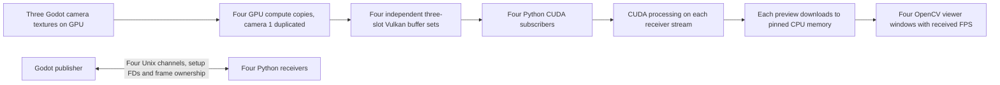
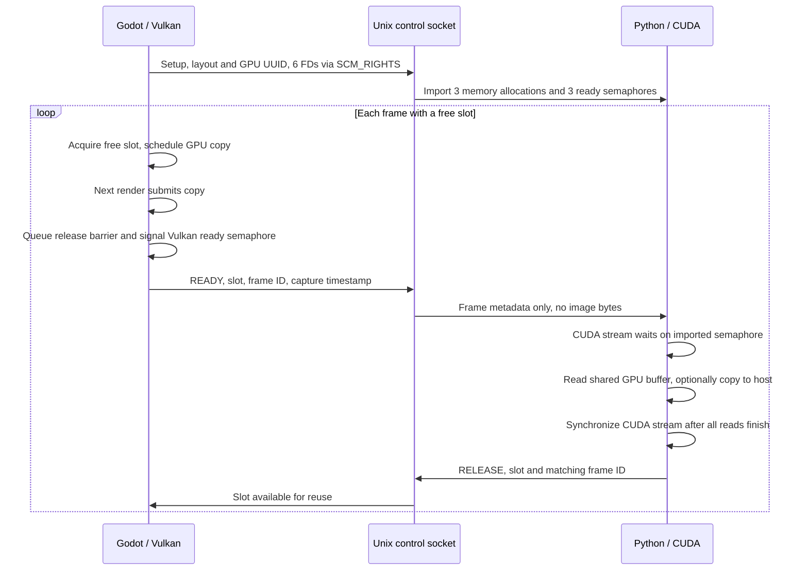

# Godot → Python GPU memory sharing

This branch renders **three 640×480 cameras at 30 FPS with 90° horizontal FOV**, with four Python viewers. Camera 2 and camera 3 sit 1 m and 2 m to camera 1's right, with the same orientation. Viewers 1 and 4 subscribe to the same camera view (camera 1); they receive independent copies of its rendered texture and each has its own GPU buffers. Godot writes RGBA8 pixels into exportable Vulkan GPU buffers. Each Python process imports its allocations into CUDA. Pixel data does not travel through the control socket or CPU shared memory.

The Python OpenCV preview downloads the image from CUDA to CPU memory for display. Treat the shared input pixels as read-only. A CUDA application can instead consume `GpuFrame.device_pointer` on `receiver.cuda.stream`, then release the frame without downloading it.

## Build

Linux x86-64 and an NVIDIA GPU/driver supporting Vulkan external memory and external semaphore FDs are required. Both processes must use the same physical GPU. CUDA Toolkit / `nvcc` is not required: the consumer uses the CUDA driver API through NVIDIA's Python bindings.

On Ubuntu 24.04, install the native build dependencies:

```bash
sudo apt install build-essential cmake ninja-build pkg-config patch libvulkan-dev \
  libx11-dev libxcursor-dev libxinerama-dev libxrandr-dev libxi-dev \
  libxkbcommon-dev libasound2-dev libpulse-dev libudev-dev
python3 -m venv --system-site-packages .venv
.venv/bin/python -m pip install -r requirements.txt
.venv/bin/python tools/build_gpu_engine.py --jobs 4
cmake --preset debug
cmake --build --preset debug
```

The engine build is pinned to Godot **4.5-stable**, commit `876b290332ec6f2e6d173d08162a02aa7e6ca46d`, matching the existing godot-cpp bindings. Its executable is `build/godot-src/bin/godot.linuxbsd.template_debug.x86_64`. It is a runtime template, without the editor. An initial source build takes several minutes and several GB of disk space.

`patches/godot-gpu-sharing.patch` makes three changes:

- Enables `VK_KHR_external_semaphore_fd` when supported. Godot already requests external memory FD support.
- Adds `RenderingDevice.storage_buffer_create_from_extension(buffer, size)`, registering an externally owned Vulkan buffer with Godot's rendering graph. Godot frees its wrapper, while the extension owns the buffer and allocation.
- Exposes `gpu_flush(false)` for shutdown, so queued compute work is submitted before external objects are destroyed.

Stock Godot cannot run this demo's GPU exporter. The patch and extension intentionally support only Vulkan. Rendering is single threaded so the extension can submit to Godot's queue without racing the renderer. The main window viewport is disabled and camera frames are explicitly drawn without presentation. This avoids a measured 2 FPS NVIDIA/X11 presentation stall on this machine, while keeping the camera rendering at its 30 FPS cap. It still requires an X11 display and is not Godot's `--headless` mode.

## Run on NVIDIA

After building, start Godot once; it renders three camera views and publishes four GPU channels:

```bash
__NV_PRIME_RENDER_OFFLOAD=1 __VK_LAYER_NV_optimus=NVIDIA_only \
  build/godot-src/bin/godot.linuxbsd.template_debug.x86_64 --path demo
```

Start one viewer per terminal. Viewers 1 and 4 show the same camera view through independent channels. A few seconds of 0 FPS during GPU/context startup are normal:

```bash
.venv/bin/python -u viewer.py
.venv/bin/python -u viewer.py --channel camera1_b
.venv/bin/python -u viewer.py --channel camera2
.venv/bin/python -u viewer.py --channel camera3
```

The first command defaults to `camera1_a`; run four viewer processes total. VS Code: run **Run camera demo (Godot + Python)**. It starts the already-built publisher and all four viewers in separate terminals without rebuilding. The publisher window is intentionally minimized; the visible camera GUIs are the OpenCV Python viewers. The **Godot publisher (background only)** debug configuration starts only Godot and does not open viewers. Run **Build GPU demo** explicitly after changing code or switching branches. Stop the publisher terminal with Ctrl+C. Press `q` or Escape in a Python window to close that preview. For a timed preview, use `viewer.py --seconds 10`.

CMake configuration registers the GDExtension in the local Godot cache, so the custom runtime can load it without an editor import. Rebuild after changing branches: ignored binaries and `.godot` caches are shared between checkouts.

## Flow and ownership



Godot schedules a compute copy after a rendered frame. That dispatch is submitted with the next rendered frame. On the next post-draw callback, a native queue submission releases the output buffer to external ownership and signals its exported binary semaphore. The copy operates on the camera texture through Godot's rendering graph, which handles its image layout and resource dependencies.



Each slot moves through `FREE → GODOT WRITING → READY → PYTHON READING → FREE`. The setup socket passes each channel's Vulkan allocation and ready-semaphore file descriptors to its viewer once with `SCM_RIGHTS`; later socket messages carry only a slot index, frame ID, and timestamp. Godot queues the copy and release barrier on the same Vulkan queue. The `READY` packet can arrive before that GPU work has finished, so the viewer does not treat the packet as pixel readiness: it queues a wait on the imported Vulkan semaphore in its CUDA stream before accessing the buffer.

The viewer keeps the slot until its CUDA work finishes. In the OpenCV path, it queues a GPU-to-host copy, synchronizes that CUDA stream, then sends `RELEASE` with the same slot and frame ID. The CUDA wait consumes the slot's binary semaphore signal, so Vulkan can signal that semaphore again on a later reuse. The release packet is the reverse ownership handoff: it is sent only after the CUDA stream has finished reading the allocation, and Godot validates its slot and frame ID before making the slot writable again. For a CUDA inference path, enqueue the inference on `receiver.cuda.stream` and call `receiver.release(frame)` only after the stream work is complete; `release()` synchronizes before sending the acknowledgement. If all three slots are held, Godot drops that capture instead of blocking the render thread. Each channel has its own frame IDs and slot pool; the two camera-1 viewers receive independent copies, not one multi-reader allocation. The FPS overlay counts completed downloads, while Godot reports submitted and dropped captures. The timestamp marks capture scheduling, not exposure time or end-to-end display latency.

Each publisher uses a Linux abstract Unix socket `\0godot-camera-gpu-<uid>-<channel>`, with `SOCK_SEQPACKET` message boundaries. The channels are `camera1_a`, `camera1_b`, `camera2` and `camera3`. Both ends verify the peer's UID. One subscriber is accepted per channel; camera 1's two channels get independent buffer sets to avoid cross-viewer ownership races. Abstract sockets disappear automatically on process exit. Descriptors are passed during setup using `SCM_RIGHTS`, not as integer values in a message.

Setup is little endian `<4s5I16s3Q>`: `GPG1`, version 1, width, height, slot count, payload bytes, GPU UUID, and three allocation sizes. Its six FDs alternate memory and ready semaphore for each slot. READY is `<4sIIQQ>`: `RDY1`, slot, startup-pattern flag, frame ID, timestamp in monotonic microseconds. RELEASE is `<4sIQ>`: `REL1`, slot, matching frame ID. Invalid packets disconnect the consumer. Each channel holds about 3.52 MiB of pixel buffers; the four channels hold about 14.1 MiB total, plus allocation alignment and driver overhead.

## Using the GPU pointer

```python
from gpu_receiver import GpuReceiver

receiver = GpuReceiver.connect()
try:
    # Wait for socket readability in a real event loop.
    frame = receiver.acquire()
    if frame is not None:
        # RGBA8, row pitch 640*4, device pointer is frame.device_pointer.
        # Enqueue CUDA work on receiver.cuda.stream after its ready wait.
        # Do not retain the pointer after release or use it on another stream
        # without explicit cross-stream dependencies.
        receiver.release(frame)  # Synchronizes the stream before acknowledging.
finally:
    receiver.close()
```

The receiver owns a CUDA context on the creating thread. Use it from that thread. Passing its pointer directly into an inference framework requires additional context and tensor-lifetime integration.

The first three published frames are a GPU-generated coordinate pattern. The preview verifies every byte, checking shared memory access, channel order and orientation before showing the animated camera. These are diagnostic frames, not camera images.

## Checks and limitations

```bash
.venv/bin/python -m unittest discover -s tests -p 'test_*.py'
.venv/bin/python tests/check_pipeline.py
.venv/bin/python tests/benchmark_gpu_sharing.py --seconds 30 --warmup 3
```

The single-channel integration check verifies slot ownership, reconnects, malformed messages and real changing pixels. The benchmark runs three cameras with four OpenCV viewers for 30 seconds after warmup and records per-process CPU/RSS plus whole-device NVIDIA utilization/VRAM. Its raw samples and process logs go under ignored `build/`. For a shorter four-viewer smoke check (opens four preview windows and runs for 10 seconds):

```bash
.venv/bin/python tests/check_multi_viewer.py
```

It reports each viewer's received FPS and writes logs under ignored `build/`.

A disconnected consumer's allocation generation is retired and never reused. **Retired generations remain allocated until publisher shutdown**, preserving allocations an old consumer may still access. Repeated reconnects therefore grow GPU memory use. This prototype needs bounded retirement and stronger crash recovery before long-running production use.

The three-camera/four-viewer configuration was measured for 30 seconds on the NVIDIA GeForce RTX 5070 Laptop GPU with driver 580.178.04. See [PERFORMANCE.md](PERFORMANCE.md) for the combined results and comparison with the other transports.

This is a trusted same-user demo with one consumer per channel. It duplicates camera 1's GPU copy for its second viewer instead of implementing multi-consumer slot acknowledgements. It does not implement inference frameworks or direct GPU display. Restart the publisher after a GPU/driver fault. No performance improvement over the other branches is claimed without a controlled benchmark.
